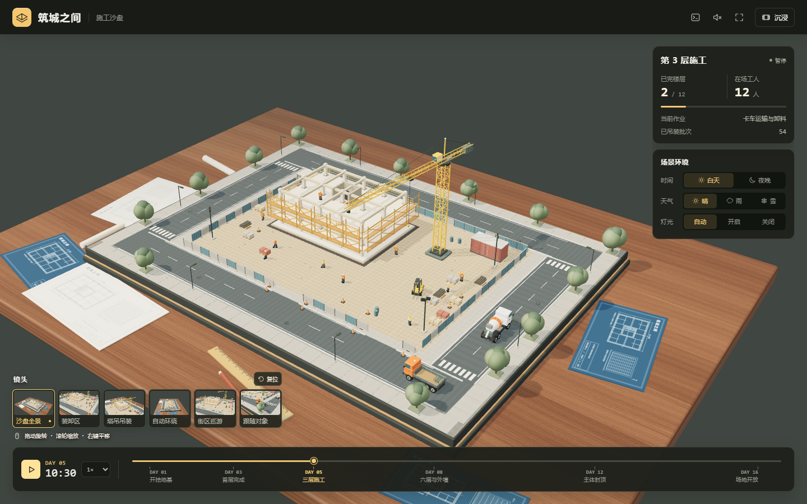

# 筑城之间 · BuildSandbox

用 Three.js 搭建的交互式微缩工地。沿时间轴回看从地基到 12 层完工，观察卡车卸料、叉车转运与塔吊吊装，还可切换昼夜、雨雪和六个机位。



## 本地运行

使用 Node.js 20.19+ 或 22.12+，在仓库目录运行：

```sh
npm ci
npm run dev
```

打开终端显示的地址。运行 `npm run build` 可生成可离线打开的 `dist/index.html`。场景和镜头配置位于 [src/scene.json](src/scene.json)，生成要求见 [建模提示词](docs/modeling-prompt.md)。
